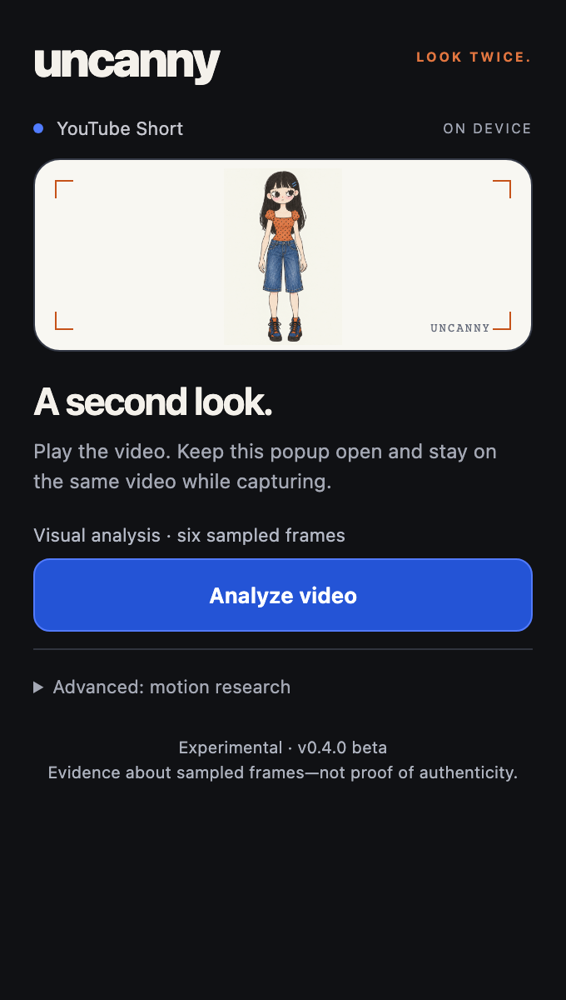

# Uncanny — Look twice.

A local-first Chrome extension that examines sampled video frames for AI-generation
signals on YouTube Shorts, Instagram Reels and TikTok. **v0.4.2 is an experimental
portfolio beta, not a validated authenticity verifier or a Chrome Web Store release.**



*Interface preview using a simulated browser-tab context; not a detection result.*

## Use it

Tested on macOS Apple Silicon with Chrome. Python 3.11 or 3.12 and several GB of
free disk space are needed. Other operating systems have not been validated.

1. Clone this repository or extract the source release ZIP.
2. From its folder, run `python3.12 detector/setup_visual.py` (or Python 3.11).
   Review the model's nonprofit-use terms when prompted. This creates `.runtime`,
   installs dependencies and downloads/verifies the approximately 330 MB model.
   `Setup-Uncanny.command` does the same if `python3` is a supported version.
3. Double-click **Start-Uncanny.command**. Keep the Terminal window open.
4. Open `chrome://extensions`, enable **Developer mode**, choose **Load unpacked**,
   and select this repository's `apps/extension` folder.
5. Play a Short, Reel or TikTok, open Uncanny to open its docked side panel, then click **Analyze video**.
   Keep the panel open and stay on the video during capture and analysis.

No paid inference API or account is needed for the main mode. Setup downloads
packages/model weights; analysis then runs locally. On the development Mac,
WaveRep inference on six frames took approximately 1.3–2.2 seconds, excluding
capture and model loading. This is not a cross-device latency guarantee.

If the UI says **Start Uncanny first**, start the launcher and retry. After an
update, reload the extension. If a port is occupied by an old detector, close its
Terminal before relaunching. Exporting frames is optional, not required to analyze.

### Optional motion research

**Advanced: motion research** captures approximately four seconds and analyzes the
first 16-frame section that passes screening. It requires approved DINOv3 weights
and the separate research Python environment. It is not required for normal use.
See [motion setup and limitations](docs/MOTION-NEXT.md). The launcher skips this
service when the optional model/dependencies are absent.

## What the models actually do

| Path | Model | Role |
| --- | --- | --- |
| Main Analyze button | WaveRep G4, a trained DINOv2-based detector | Measures generation-related visual signals in six sampled frames |
| Optional motion experiment | Hugging Face DINOv3 + STALL | Compares spatial/temporal features with real-video reference statistics |
| Offline training pilot | Frozen DINOv3 + an Uncanny-trained linear classifier | Tests supervised adaptation on a fixed DeepAction split; separate from the app |
| Legacy research only | Community Forensics and other baselines | Preserved comparison/rollback code; not the current main model |

The foundation models are **pretrained**, not trained by this project. The offline
training pilot fits a separate classifier on frozen DINOv3 features.
Uncanny implements capture, preprocessing, local serving, GPU acceleration,
quality screening, evidence presentation and repeatable evaluation. Hashtags and
platform AI labels are not passed to the models. Audio is not analyzed.

The main display requires at least five of six frame signs to agree:

- **AI-like visual signal:** supporting model evidence, not proof.
- **No strong AI evidence:** generated content can still be missed; not a real verdict.
- **Inconclusive:** mixed evidence or insufficient distinct frames.

Raw signals appear in expandable details, not as claimed accuracy percentages.

### Training work

The [training pilot](docs/TRAINING-PILOT.md) uses verified public video files,
separate training/validation/test activities, a generator excluded from training,
and an additional compressed view of each training clip. It compares the locked
classifier with the app's current detector on identical captured pixels, then
checks existing user-labeled exports separately. Private captures and dataset/model
files stay outside Git. The code does not automatically replace the live detector.

**First training result:** the candidate reduced false flags on the public test
from 7/20 real clips to 2/20, but AI detections fell from 116/120 to 82/120. It also
underperformed on saved user exports, so it was not deployed. See the
[completed comparison and next training step](docs/TRAINING-RESULTS-2026-11-17.md).

## Measured results and honest limits

On 11 already-inspected, user-labeled motion captures, the current main-model
display policy flagged 4/5 AI samples and missed one. Of 6 real samples, five
returned no strong AI evidence and one was inconclusive; none received an AI flag.
On an earlier nine-video set, it flagged 2/4 AI samples, missed one and abstained
on one; all five real samples were negative. These sets were used during development,
labels were not independently authenticated, and this is **not a production accuracy estimate**.

**Subsequent user testing found a real-video false positive.** The model flagged
five of six clean frames in that capture. See [the investigation](docs/FALSE-POSITIVE-2026-11-16.md).
The earlier development-set results did not establish reliability on new examples.

See [the full WaveRep comparison](docs/WAVEREP-2026-11-16.md), including the less
conservative upstream rule, and [motion evaluation](docs/MOTION-EVALUATION.md).
Compression, animation, unseen generators, editing and mixed content remain hard.
The model sees cropped/resized samples, not the whole video. The motion cut screen
is a heuristic and can miss transitions. Platform layouts and capture restrictions
can change; support across every layout has not been established.

## Privacy and architecture

Chrome MV3 popup → frame capture → loopback Python service → model → evidence UI.
The service listens only on `127.0.0.1` (8767 visual, 8768 optional motion).
Frames stay in memory unless the user exports a sample. Exported JSON includes
frames and the video's URL. No analytics or cloud inference is implemented.
See [PRIVACY.md](PRIVACY.md) for permissions and retention.

## Development

```sh
npm test
npm run check
# Use a Python environment with detector/requirements.txt installed:
.venv/bin/python -m unittest discover -s tests -p '*_test.py'
```

The beta was checked with 45 Python tests, 15 JS tests, JS syntax checks and live
HTTP/model checks. Popup ready/result states were rendered at 340px wide without
horizontal overflow. A clean-machine installation has not yet been independently
verified; the supplied installer has been reviewed and syntax checked.

`UNCANNY_PYTHON=/path/to/python` overrides the runtime. Otherwise the launcher
prefers `.runtime/bin/python` for the main model, with the original development
Anaconda installation as fallback. Research scripts and private captures are kept
separate from normal usage. See [release notes](CHANGELOG.md) and [roadmap](docs/ROADMAP.md).

## License and model attribution

Application code is MIT except identified third-party/adapted research material.
WaveRep code/model usage is restricted to nonprofit/informational purposes;
[its license](detector/licenses/WaveRep.txt) is not replaced by this repo's MIT license.
STALL-derived scoring is [CC BY-NC 4.0](detector/licenses/STALL.txt); DINOv3 has its
own Meta license and access conditions. See [THIRD_PARTY.md](THIRD_PARTY.md).
Model weights, credentials and private captures are excluded from the repository
and release archive. Do not assume this beta is licensed for commercial deployment.

Version 0.4.1 uses Chrome’s native side panel (Chrome 116+) so controls sit beside the page rather than floating over the video. Reload the extension after updating; Chrome may request the new sidePanel permission. Click the toolbar icon on each new tab to grant temporary access.
